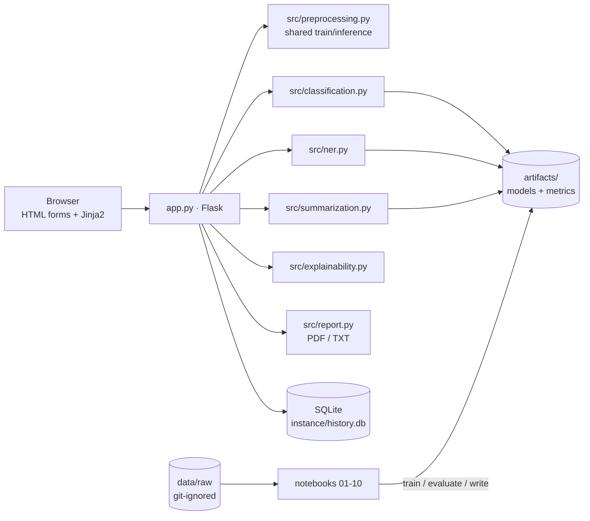

# MediScope

> **Making medical research more understandable through intelligent text analytics.**

MediScope is a locally running healthcare-research analytics platform. Give it a medical abstract or paper (pasted text, PDF or TXT) and it returns the **structure** of the text (sentence roles), the **chemicals and diseases** it mentions, and a **machine-generated summary** — with scores, term attributions, model information and timings. It combines classical ML, a BiLSTM, fine-tuned transformers, biomedical NER and abstractive summarization behind a server-rendered Flask app. **Everything runs on your machine; there are no external APIs.**

> ⚠️ **Educational research project — not a diagnostic or clinical decision tool.** Scores are *uncalibrated* model outputs and summaries are *machine generated and unverified*.

## Contents
[Problem](#problem-statement) · [Features](#features) · [Stack](#technology-stack) · [Architecture](#architecture) · [Datasets](#dataset-sources-and-licences) · [Notebooks](#notebooks) · [Methodology](#methodology) · [Results](#evaluation-results) · [Install](#installation) · [Train](#training-and-model-artifacts) · [Run](#running-the-app) · [Tests](#testing) · [Structure](#project-structure) · [Limitations](#limitations) · [Ethics](#ethical-considerations) · [Future work](#future-improvements)

## Problem statement
Biomedical abstracts are dense and numerous. Readers benefit from (1) seeing *which sentence plays which role* (aim, method, finding, interpretation), (2) quickly spotting the chemicals and diseases involved and (3) a short summary for triage. MediScope builds these three capabilities with rigorous, reproducible ML experimentation and a transparent interface.

**Motivation.** A portfolio-grade applied-ML project: real public biomedical data, honest evaluation (shared test subset, bootstrap CIs, ablations, error analysis, calibration), explainability, and a usable product.

## Features
* **Abstract Classifier** — per-sentence rhetorical role (Background / Objective / Methods / Results / Conclusions), score distribution chart, alternative roles, important terms (exact linear coefficients, or occlusion for neural models), model info; scores are labelled *uncalibrated*.
* **Entity Extraction** — BioBERT token classifier (Chemical, Disease) or dictionary baseline; highlighted text, legend toggles, per-entity confidence, frequency table, category chart.
* **Summarization Studio** — chunking for long documents, length control (short/medium/long), original-vs-summary comparison with click-to-locate, extractive key sentences next to the generated summary.
* **Research Explorer** — runs all of the above on one document → unified report with statistics, key terminology, key findings, model information and processing time; export **PDF or TXT**.
* **Model Laboratory** — leaderboard with bootstrap CIs, F1 / training-time / latency charts, confusion matrices, calibration, NER and summarization tables, dataset cards — all rendered from experiment artifacts.
* **Research History** — local SQLite; view, export, delete. Uploaded files are never stored.
* Light/dark theme, keyboard-accessible, responsive (desktop primary), PDF/TXT upload with validation, no mock predictions — a missing model produces a message naming the notebook that creates it.

## Technology stack
Python 3.12 · Flask/Jinja2 · SQLite · NumPy, pandas, SciPy · scikit-learn, XGBoost, imbalanced-learn · NLTK, gensim (Word2Vec), regex · PyTorch · Hugging Face Transformers/Tokenizers · SHAP, LIME · rouge-score, bert-score · pypdf, reportlab · Matplotlib, Seaborn, Plotly, WordCloud (notebooks) · Chart.js (vendored) · pytest · Jupyter. Fonts (self-hosted, OFL): Source Serif 4, IBM Plex Sans.

## Architecture

No REST API: pages are server-rendered from form posts; models are loaded lazily once per process and cached; preprocessing code is shared by notebooks and app.

## Dataset sources and licences
Full provenance in [`data/README.md`](data/README.md). **None of the datasets carries a clear open licence** — they are used for research only, never committed or redistributed.

| Dataset | Task | Counts (verified) | Licence status |
|---|---|---|---|
| PubMed 20k RCT (Dernoncourt & Lee 2017) | sentence-role classification | 180,040 / 30,212 / 30,135 sentences (15,000 / 2,500 / 2,500 abstracts) | none explicit; MEDLINE-derived, some abstracts may be copyrighted |
| BC5CDR via T-NER (Li et al. 2016) | NER (Chemical, Disease) | 5,228 / 5,330 / 5,865 sentences | hub: "other" |
| PubMed summarization, test split (Cohan et al. 2018) | summarization eval | 6,658 articles | none declared |

> "Research category" here means the **rhetorical role of each sentence** (that is what PubMed RCT labels), aggregated per abstract — not topic classification.

## Notebooks
All ten notebooks are executed and contain their outputs; observations are computed from data, not typed.

| # | Notebook | What it does |
|---|---|---|
| 01 | `dataset_understanding` | licences, shapes, dtypes, missing values, duplicates, leakage checks, class distributions, BC5CDR & summarization inspection |
| 02 | `extensive_eda` | length/vocabulary statistics, Zipf/Heaps, n-grams, distinctive words (log-odds), position × class, Kruskal–Wallis, word clouds, medical-term lexicon |
| 03 | `preprocessing_and_feature_engineering` | tokenisers, negation-safe stopwords, stemming/lemmatisation, 6 strategies × seeds, n-gram ablation, TF-IDF vs Word2Vec, OOV analysis |
| 04 | `classical_ml_experiments` | NB, LR, SVM, RF, XGBoost; group-aware CV, random search, confusion matrices, position ablation, learning curve |
| 05 | `deep_learning_experiments` | BiLSTM, early stopping, init/seq-length/dropout ablations |
| 06 | `transformer_finetuning` | tokenisation/attention demos, AdamW + warm-up, DistilBERT vs BERT vs BioBERT, hyper-parameter study |
| 07 | `biomedical_ner` | BIO + sub-word alignment, dictionary baseline, BioBERT, strict entity-level eval, error taxonomy |
| 08 | `medical_summarization` | extractive vs abstractive, chunking, ROUGE, BERTScore, factual-consistency proxies, length control |
| 09 | `explainability_and_error_analysis` | confusions, FP/FN, error patterns, calibration/ECE, SHAP, LIME, occlusion, fairness limits |
| 10 | `model_benchmarking` | unified leaderboard, bootstrap CIs, McNemar, rule-based deployment choice |

## Methodology
* **ML.** Group-aware CV (`GroupKFold` on abstract id), random search on macro-F1, test set used once; preprocessing lives *inside* the sklearn pipeline (no leakage).
* **NLP.** One regex-based, negation-preserving preprocessing module shared by training and inference; the strategy actually deployed was chosen empirically in notebook 03.
* **Transformers.** Hugging Face encoders + manual PyTorch loop (AdamW with decoupled weight decay, linear warm-up/decay, gradient clipping, best-checkpoint restore, auto GPU/CPU + mixed precision when CUDA exists).
* **NER.** BIO tags aligned to the first word-piece (others `-100`); strict span-level P/R/F1 per type.
* **Explainability.** Linear coefficients, occlusion, SHAP, LIME; attention is deliberately *not* used as explanation. No claim of medical causation.

## Evaluation results
All numbers come from the executed notebooks (`artifacts/*/metrics.json`, `benchmark.json`); single seed, CPU-only training. **Read the "Train n" column — budgets differ.**

### Sentence-role classification (PubMed 20k RCT, shared 2,000-sentence test subset, bootstrap 95% CI)

| Model | Family | Train n | Macro-F1 (95% CI) | Accuracy | Weighted-F1 | Train s | ms/sent | MB |
|---|---|---|---|---|---|---|---|---|
| **BioBERT v1.1** *(deployed)* | transformer | 3,001 | **0.799** (0.775–0.819) | 0.858 | 0.857 | 1129 | 60.05 | 433.3 |
| Linear SVM | classical | 180,040 | 0.789 (0.765–0.811) | 0.843 | 0.840 | 48 | 0.13 | 9.3 |
| Logistic Regression | classical | 180,040 | 0.771 (0.747–0.791) | 0.825 | 0.826 | 143 | 0.10 | 6.2 |
| BiLSTM | deep learning | 30,000 | 0.762 (0.738–0.783) | 0.820 | 0.820 | 439 | 0.58 | 13.0 |
| BERT-base | transformer | 3,001 | 0.748 (0.724–0.770) | 0.809 | 0.808 | 1157 | 84.41 | 438.0 |
| Logistic Regression (30k) | classical | 30,000 | 0.747 (0.722–0.769) | 0.809 | 0.809 | 37 | 0.13 | 2.7 |
| Naive Bayes | classical | 180,040 | 0.743 (0.718–0.765) | 0.808 | 0.806 | 35 | 0.17 | 10.2 |
| DistilBERT | transformer | 3,001 | 0.743 (0.718–0.767) | 0.806 | 0.804 | 762 | 38.37 | 267.8 |
| Random Forest | classical | 30,000 | 0.694 (0.666–0.717) | 0.760 | 0.755 | 97 | 0.20 | 31.8 |
| Logistic Regression (3k, matched to transformers) | classical | 3,001 | 0.693 (0.668–0.714) | 0.757 | 0.757 | 3 | 0.11 | 0.3 |
| XGBoost | classical | 30,000 | 0.690 (0.662–0.714) | 0.750 | 0.746 | 155 | 0.12 | 0.4 |

* **Matched budget (3,001 sentences):** every transformer beats Logistic Regression (0.743–0.799 vs 0.693 macro-F1); the biomedical model (BioBERT) is best (+0.05 over BERT-base, though cased-vs-uncased is a confound). Transformers were fine-tuned for **one epoch** on ~1.7% of the training data.
* **Statistics:** the top two (BioBERT vs Linear SVM) differ detectably in accuracy by McNemar (p = 0.045) although their bootstrap CIs overlap. Many neighbouring models have overlapping CIs at n = 2,000, so their ordering is unresolved.
* **Deployment rule** (notebook 10): highest macro-F1 under latency ≤ 150 ms and size ≤ 600 MB, ties (paired McNemar p ≥ 0.05) → cheapest. This selected BioBERT. *(The rule was revised after seeing the first results, from CI-overlap to the paired test; the notebook documents this.)* The Linear SVM is ~460× faster and ~47× smaller and loses only ~0.01 macro-F1 — a reasonable alternative; every trained model is selectable in the app.
* **Position matters** (notebook 04): Logistic Regression on text alone 0.760 macro-F1, position alone 0.554, text + position **0.825**. Sentence-only models leave much of the signal unused.
* **Calibration** (notebook 09): scores are not probabilities — e.g. Logistic Regression is over-confident, the SVM's softmax-of-margins under-confident (ECE 0.248).
* **Preprocessing** (notebook 03): the plain-lowercase `raw` strategy beat my regex "clean", stemming and stopword-removal strategies (stopword removal was clearly worst); (1,2)-gram TF-IDF beat unigrams by +0.022; TF-IDF beat averaged Word2Vec by +0.038.

### Biomedical NER (BC5CDR, strict entity-level, 1,000-sentence test subset)

| System | Train data | Precision | Recall | F1 |
|---|---|---|---|---|
| **BioBERT token classifier** | 1,000 sentences, 2 epochs | 0.833 | 0.869 | **0.850** |
| Dictionary lookup | same 1,000 sentences | 0.858 | 0.455 | 0.595 |
| Dictionary lookup | all train + dev (10.5k sentences) | 0.873 | 0.698 | 0.775 |

### Summarization (15 PubMed-summarization test articles — small sample)

| System | ROUGE-1 | ROUGE-2 | ROUGE-L | BERTScore-F1* | words |
|---|---|---|---|---|---|
| TextRank (extractive) | 0.401 | 0.163 | 0.230 | 0.803 | ~240 |
| Lead-k (extractive) | 0.340 | 0.105 | 0.176 | 0.773 | ~252 |
| T5-small medical (pretrained, abstractive) | 0.308 | 0.115 | 0.194 | 0.786 | ~82 |
| T5-small base (zero-shot) | 0.158 | 0.052 | 0.115 | 0.750 | ~38 |

\*BERTScore uses `distilbert-base-uncased` (not roberta-large), so it is not comparable with published values. The extractive baselines are ~3× longer than the abstractive summaries and ROUGE favours overlap; the medical T5 clearly beats the base T5 and numbers it states are mostly (≈92%) present in the source. The summarizer was **not fine-tuned** here, and the benchmark text is lower-cased/tokenised unlike pasted prose.


## Installation
```bash
git clone https://github.com/TusharPatra26/MediScope.git && cd MediScope
python -m venv venv
venv\Scripts\activate            # Windows   (Linux/macOS: source venv/bin/activate)
pip install -r requirements.txt
```
Requires Python 3.10+ (developed on 3.12). CPU is enough; a CUDA build of PyTorch is optional.

## Dataset preparation
```bash
python -m src.data               # ≈100 MB into data/raw/ (PubMed RCT 39 MB, BC5CDR 4 MB, summarization test 58 MB)
python -m src.data --no-summ     # skip the 58 MB summarization split
```

## Training and model artifacts
Model weights are **not in Git** (size). Run the notebooks in order (Jupyter Lab, kernel = your venv):
```bash
jupyter lab notebooks/
```
Order: `03 → 04 → 05 → 06 → 07 → 08 → 09 → 10`. Pretrained weights are downloaded from the Hugging Face Hub on first use: DistilBERT ≈ 270 MB, BERT-base ≈ 440 MB, BioBERT ≈ 430 MB, T5-small ×2 ≈ 480 MB.

| Artifact | Created by | Used by |
|---|---|---|
| `artifacts/classification/models/*.joblib`, `bilstm/`, `transformers/*` | nb 04, 05, 06 | classifier |
| `artifacts/classification/deployed.json`, `artifacts/evaluation/benchmark.json` | nb 10 | default model, Model Laboratory |
| `artifacts/ner/biobert/`, `dictionary.json` | nb 07 | entity extraction |
| `artifacts/summarization/t5_medical/` | nb 08 | summarizer |

Compute-limit knobs live in `config.py` (`TRAIN_SUBSET_SENTENCES`, batch size, epochs, max length) and in each notebook's config cell. **Honest scope:** this project was trained on a CPU-only laptop, so transformers and NER were fine-tuned on **small subsets** and the summarizer is **pretrained, not fine-tuned** — notebooks state the exact budgets. For larger runs use a GPU (e.g. Colab) and raise the config values.

## Running the app
```bash
python app.py                    # http://127.0.0.1:5000
```
Models are preloaded in a background thread. If an artifact is missing, the relevant page says which notebook to run.

## Testing
```bash
python -m pytest -q
```
Tests cover preprocessing, validation, uploads (valid/invalid/empty/oversized/fake PDF), entity-level metrics, BIO alignment, chunking, missing-artifact behaviour, routes, CSRF, history and exports, and real inference when artifacts exist.

## Project structure
```
app.py  config.py  requirements.txt  PROJECT_STATUS.md
data/            README.md (provenance); raw/ processed/ are git-ignored
notebooks/       01 … 10 (executed)
src/             data · preprocessing · features · classification · ner · summarization ·
                 evaluation · explainability · report · utils
artifacts/       metrics, benchmark, figures (weights git-ignored)
templates/       base + 8 pages + components/ (Jinja includes)
static/          css/ js/ (+ vendored Chart.js) fonts/
tests/           test_preprocessing · test_models · test_app
instance/        history.db, log (git-ignored)
```
`PROJECT_STATUS.md` tracks phases, files, training status, tests and known issues.

## Limitations
Sentences are classified in isolation (a position-aware ablation shows how much that costs); scores are uncalibrated; transformer/NER budgets are small; summaries can hallucinate (a proxy check is reported, not a guarantee); randomized-trial abstracts only; PDFs must contain extractable text; benchmark latencies were measured on a shared CPU; single seeds, so small differences are within noise.

## Ethical considerations
Not for clinical use or patient data. Public, de-identified research text only. Uploads are read in memory and never stored; history keeps results and short excerpts and is erasable. Dataset licences are unclear (MEDLINE-derived), so data are used for research only and not redistributed. Attributions do not imply causation; no demographic data exist, so group fairness could not be measured.

## Future improvements
Sequential sentence models (BiLSTM-CRF / hierarchical transformers) to use position; full-data and GPU fine-tuning of the transformers; calibration (temperature scaling); fine-tune the summarizer on the PubMed training split; more entity types (genes, drugs vs treatments); multi-seed runs and CIs for transformers.

## Attribution
PubMed 20k RCT (Dernoncourt & Lee, 2017) · BC5CDR (Li et al., 2016) · PubMed summarization (Cohan et al., 2018) · BERT (Devlin et al.), DistilBERT (Sanh et al.), BioBERT (Lee et al., 2020), T5 (Raffel et al.), `Falconsai/medical_summarization` · Source Serif 4, IBM Plex Sans (SIL OFL 1.1) · Chart.js (MIT).
